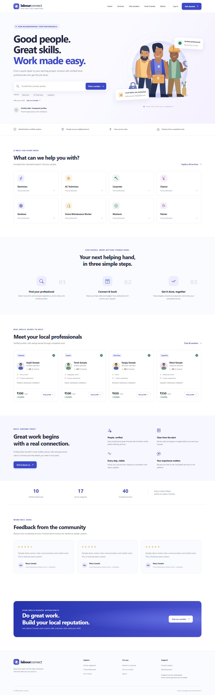

# Labour Connect

A working local labour and service marketplace for an MCA mini project. Customers discover verified professionals, book them directly or publish open jobs, follow service progress, record payments, review completed work, and raise complaints. Workers are approved by an administrator before they can sign in or offer services.

## Stack and architecture

- Python 3.12+, Django 5.2 LTS, MySQL 8.0.11+ (verified against MySQL 8.4.9), Django ORM.
- Django templates, HTML5, custom CSS, Bootstrap 5.3.8, Bootstrap Icons 1.13.1, JavaScript, Chart.js 4.5.1.
- Optional Google Maps JavaScript API and Places API (New); normal address input and browser geolocation work without a key.
- Frontend libraries are shipped locally in `static/vendor/`, with licences. No CDN is needed for the core UI.
- Separate Django apps own models, forms, views and services. Transactional business rules live in service modules, so future API or gateway adapters can reuse them.

```text
labour_connect/
├── manage.py, requirements.txt, .env.example, Start-Demo.ps1
├── config/             settings, URLs, WSGI and ASGI
├── accounts/           custom User, authentication, profile and role decorators
├── customers/          customer dashboard and service history
├── workers/            profiles, search, availability and private documents
├── jobs/               bookings, open jobs and transactional workflows
├── payments/           payment records and the explicit demo provider
├── reviews/            completed-service review eligibility
├── notifications/      database notifications and optional email delivery
├── complaints/         scoped complaints and administrator responses
├── adminpanel/         custom administrator dashboard, moderation and analytics
├── core/               categories, validation, shared forms, helpers and tests
├── templates/          reusable components and role-specific pages
├── static/             custom theme, JavaScript, SVG artwork and local libraries
├── scripts/            isolated Windows demo server
└── docs/               model/workflow notes, verification report and screenshots
```

## Installation on Windows

Install Python 3.12+ and MySQL Server 8.0.11+ (MySQL 8.4 LTS is suitable). Open PowerShell or CMD in this directory.

```powershell
python -m venv .venv
.venv\Scripts\Activate.ps1
python -m pip install -r requirements.txt
```

CMD activation:

```bat
.venv\Scripts\activate.bat
```

If PowerShell blocks activation, use `.venv\Scripts\python.exe` instead of `python`; activation is optional.

### Option A: isolated local demo

This starts a separate MySQL instance on port 3307 using `.local/mysql/`, applies migrations, seeds fictional data, and starts Django. It does not reconfigure an installed MySQL service. The first launch creates a random-secret `.env` if one is absent.

```powershell
.\Start-Demo.ps1
```

If MySQL is installed somewhere else:

```powershell
.\Start-Demo.ps1 -MySQLServer 'C:\path\to\mysql\bin\mysqld.exe'
```

Open the URL printed in the terminal. Normally it is `http://127.0.0.1:8000/`. Demo passwords are generated and saved locally in `demo_accounts.txt`. Press Ctrl+C to stop. Do not run two copies against the same data directory or port.

Run `.\Start-Demo.ps1 -CheckStartup` to initialize/check the application and stop automatically after an HTTP 200 probe. If PowerShell blocks the launcher script, run `.venv\Scripts\python.exe scripts\demo_server.py` directly.

The prepared workspace’s `.env` uses its host-only interface and port 3307 to work within the execution sandbox. For an ordinary installation, start from `.env.example` or let the demo launcher generate a new local environment. `.env`, `.local`, uploaded files and generated credentials are excluded from the source archive.

### Option B: your own MySQL database

```powershell
Copy-Item .env.example .env
```

Generate a secret and put the result into `.env`:

```powershell
python -c "import secrets; print(secrets.token_urlsafe(64))"
```

Connect to MySQL as a database administrator, then run this SQL with your own password:

```sql
CREATE DATABASE labour_connect
CHARACTER SET utf8mb4 COLLATE utf8mb4_unicode_ci;
CREATE USER 'labour_app'@'127.0.0.1' IDENTIFIED BY 'choose-a-unique-password';
GRANT ALL PRIVILEGES ON labour_connect.* TO 'labour_app'@'127.0.0.1';
-- Needed only for Django's disposable test database:
GRANT ALL PRIVILEGES ON test_labour_connect.* TO 'labour_app'@'127.0.0.1';
```

Set `DB_NAME`, `DB_USER`, `DB_PASSWORD`, `DB_HOST`, and `DB_PORT` in `.env` to match. Port 3306 is usual for an existing MySQL server. Use a separate migration account and narrower runtime grants for a production deployment.

```powershell
python manage.py makemigrations --check --dry-run
python manage.py migrate
python manage.py createsuperuser
python manage.py seed_categories
python manage.py runserver
```

Migrations are already committed; `makemigrations` is only needed after model changes. `createsuperuser` sets role `ADMINISTRATOR`; public registration offers only customer and worker roles.

For fictional sample content instead of a clean database:

```powershell
python manage.py seed_demo
```

`seed_demo` is idempotent. It creates 17 categories, three customers, ten approved workers, two pending workers, one rejected worker, an administrator, completed and requested bookings, open jobs, simulated payments, sample reviews, notifications, a complaint, and an announcement. All names, avatars, documents and reviews are fictional. Passwords are randomly generated and existing passwords are preserved on rerun.

## Environment configuration

| Variable | Purpose |
|---|---|
| `SECRET_KEY` | Required unique secret. The application refuses a missing or sample secret. |
| `DEBUG` | `True` only during development. |
| `ALLOWED_HOSTS` | Comma-separated hostnames or IP addresses. |
| `DB_NAME`, `DB_USER`, `DB_PASSWORD`, `DB_HOST`, `DB_PORT` | MySQL connection; credentials are never committed. |
| `GOOGLE_MAPS_API_KEY` | Optional browser key restricted to your site's HTTP referrers. |
| `GOOGLE_MAPS_MAP_ID` | A Google map ID; `DEMO_MAP_ID` works for development. |
| `EMAIL_BACKEND` | Console backend for local use; SMTP backend for actual delivery. |
| `EMAIL_HOST`, `EMAIL_PORT`, `EMAIL_USE_TLS`, `EMAIL_HOST_USER`, `EMAIL_HOST_PASSWORD` | SMTP configuration. |
| `DEFAULT_FROM_EMAIL` | Sender address. |
| `SEND_NOTIFICATION_EMAIL` | Optional important notification email delivery; database notices are always created. |
| `SECURE_SSL_REDIRECT`, `SESSION_COOKIE_SECURE`, `CSRF_COOKIE_SECURE` | Enable for HTTPS production. Defaults are secure with `DEBUG=False`. |

### Google Maps

Enable Maps JavaScript API and Places API (New) in a Google Cloud project and supply a browser-restricted key. The address widget uses `PlaceAutocompleteElement` and fetches `formattedAddress` and location coordinates. The `address` column stores that formatted address or the manually entered address; latitude and longitude remain separate validated columns. Maps display worker and service locations where coordinates are available. Geolocation runs only when the user clicks a location-sharing button.

Without a key, the SDK is not loaded, map elements remain hidden, and ordinary address forms continue working. The live Google API requires your key and billing-enabled project; see [Google’s widget documentation](https://developers.google.com/maps/documentation/javascript/place-autocomplete-new).

### Email

Password reset uses Django's token-based flow and avoids revealing whether an email belongs to an account. With the console backend, reset links are printed in the server terminal. For actual email, use `django.core.mail.backends.smtp.EmailBackend` and configure SMTP variables. Notification email runs after transaction commit so mail errors do not undo a booking or verification decision.

## Roles, workflows and business rules

1. Customers register, sign in, browse active approved workers, book an available worker or post an open job.
2. Workers register with a photo and identity document. Status starts `PENDING`. Pending or rejected login creates no authenticated session. Every protected worker route independently checks approval, including manually entered URLs.
3. Administrators review full profiles and authenticated document downloads, approve or reject with a reason, and reactivate or deactivate accounts. Decisions create notifications and a verification history entry.
4. Direct booking: `REQUESTED → ACCEPTED → IN_PROGRESS → COMPLETED`. A worker may reject only a requested booking. A customer may cancel requested or accepted bookings, and open or accepted jobs, before work starts. Completed, rejected and cancelled records are terminal.
5. Open job: `OPEN → ACCEPTED → IN_PROGRESS → COMPLETED`. Acceptance uses `transaction.atomic()` and a primary-key `select_for_update()` lock. A racing second worker receives an already-assigned message. Only the assigned worker can start or complete the job.
6. Payment records are permitted only after completion, one per service, for the agreed budget. Cash and UPI start `PENDING`; the assigned worker confirms `PAID` or marks `FAILED`. Administrators can record a refund of a paid record. A failed or refunded record is terminal. Payment records do not initiate off-platform transfers.
7. `DEMO` online payments explicitly simulate a paid record and transfer no money. Confirmed earnings include all `PAID` records, including clearly labelled demo records; refunded and failed amounts are excluded. A future real gateway should replace the provider adapter and verify webhook signatures.
8. Only the customer who owns a completed service can review its assigned worker. One review per service, ratings 1–5, with database constraints and service-level validation. Averages and review counts are queried from the database.
9. Complaints can reference only the submitter's own service. Administrators respond and update status; the complainant is notified. Notifications and mark-read actions are scoped to the recipient.

Hourly profile rates are indicative; a booking's budget is the total agreed amount. Nearest sorting requires shared coordinates. Search filters combine keywords, skills, designation, category, working area, experience, rating, hourly rate and availability, with pagination preserving query parameters.

## Important URLs

| URL | Purpose |
|---|---|
| `/`, `/services/`, `/about/` | Public marketplace and information. |
| `/workers/`, `/workers/<id>/` | Verified search and public professional profiles. |
| `/accounts/register/`, `/accounts/login/` | Registration and login. |
| `/accounts/password/reset/`, `/accounts/password/change/` | Reset or change a password. |
| `/customer/dashboard/`, `/customer/jobs/new/`, `/customer/book/<worker-id>/` | Customer workspace, open job posting and booking. |
| `/worker/dashboard/`, `/worker/jobs/available/`, `/worker/availability/` | Approved worker workspace. |
| `/worker/documents/`, `/documents/<id>/download/` | Private uploads and authorized downloads. |
| `/work/job/<id>/`, `/work/booking/<id>/` | Service details and participant-owned actions. |
| `/payments/`, `/reviews/`, `/notifications/`, `/complaints/` | Histories and support. |
| `/adminpanel/`, `/adminpanel/verifications/`, `/adminpanel/analytics/` | Custom administration. |
| `/django-admin/` | Auxiliary Django admin for users and categories. |

## Security

Django hashes passwords and handles sessions, CSRF, reset tokens, and template escaping. Role decorators and object-level ownership checks protect all service mutations. No administrator registration or role-changing profile field is exposed. Login attempts are limited per IP in the configured Django cache. Configure a shared cache for multiple production processes.

Uploads have extension, content and 5 MB size checks; images are verified by Pillow and PDFs must have a PDF signature. Private documents are stored under `private_media/`, outside public `media/`; their storage deliberately provides no public URL. Downloads require an approved owner or administrator, use attachment disposition, and disallow caching. This validation is not a malware-scanning service.

Use HTTPS with `DEBUG=False` and correct host and cookie settings for deployment. Serve only the public `media/` tree; never expose `private_media/` through Nginx, Apache or a storage bucket. Collect static assets with `python manage.py collectstatic --noinput`. Use a production WSGI server and keep `.env` and generated credentials private. Review [Django’s database documentation](https://docs.djangoproject.com/en/5.2/ref/databases/) for supported server configuration.

## Tests and verification

With MySQL running and test-database permissions granted:

```powershell
python manage.py check --database default
python manage.py makemigrations --check --dry-run
python manage.py test core.tests --noinput
```

The suite covers registration, validation, approval and rejection, session and role gates, worker search, service ownership, strict transitions, transactional concurrent acceptance on MySQL, payment recording and earnings, reviews, notification ownership, complaint responses, private documents, password reset/change, announcement audiences, template compilation, role page rendering, and local-month aggregation.

See `docs/VERIFICATION.md` for the recorded final test and browser results. Browser screenshots are saved in `docs/screenshots/`; they are actual rendered application pages.

The final run passed **57 Django tests against MySQL** and **64 real-browser checks**, including all six requested viewport widths. Read [the implementation report](docs/IMPLEMENTATION_REPORT.md) for the delivered modules, models and verification limits.



## Troubleshooting

- **MySQL connection refused:** start MySQL, check port and host, and match the MySQL account's allowed host. A server on port 3306 differs from the isolated demo on 3307.
- **Demo port already in use or data file locked:** stop the other instance. Read `.local/mysql.log`. Never point the demo runner at an existing production data directory.
- **Access denied creating `test_labour_connect`:** grant the test database permissions above; Django creates and drops a disposable test database.
- **Missing SECRET_KEY:** copy `.env.example` and replace the sample value with a random secret.
- **Worker cannot sign in:** check verification status and account activation in the custom administrator dashboard.
- **No workers found:** only active, approved workers in active categories appear. Run `seed_categories` for a clean setup, or `seed_demo` for fictional profiles.
- **Reset email not arriving:** local console mode prints the link. Configure and verify SMTP to send actual email.
- **Map not visible:** supply a valid restricted Google key, enable both APIs, and check Google Cloud billing. Manual address entry remains available.
- **mysqlclient installation on Windows:** use supported 64-bit Python 3.12 with available wheels. If a wheel is unavailable for your platform, follow mysqlclient's official build instructions.
- **PowerShell virtual environment activation is blocked:** run `.venv\Scripts\python.exe manage.py ...` directly instead of changing system execution policy.

## Future extensions

Real payment gateways, WebSocket notifications, chat, live tracking, OCR, multilingual UI, PWA and mobile APIs are extension points, not claimed current features. Model relations, reusable workflow services and the payment provider adapter provide a foundation for them.
