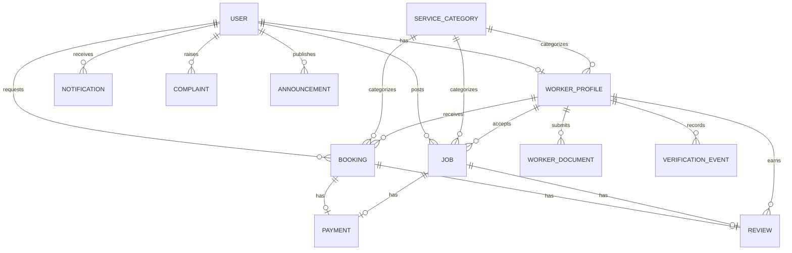

# Data model and service boundaries



`User` extends Django `AbstractUser` with immutable-through-profile role, contact details, optional coordinates and a photo. Administrators are created through `createsuperuser`. Customer data fits on User; a duplicate CustomerProfile table is unnecessary.

`WorkerProfile` keeps professional data separate from authentication. Documents use a private storage backend. Verification events preserve administrator, timestamp, decision and reason. Ratings, review counts, completed work and paid earnings are computed from related records rather than maintained as potentially stale counters.

`Booking` and `Job` share an abstract service model. Jobs may be unassigned only while open or cancelled. The workflow service locks the service primary key before checking and changing status; job acceptance holds the lock through assignment and notification creation. `completed_at` supports actual completion-month charts.

Payments and reviews each use one-to-one links to Booking and Job plus an XOR constraint requiring exactly one service. Uniqueness prevents duplicate records at database level; transactions lock the service before eligibility checks and insertion. Complaints allow at most one related service and choices are scoped to the submitter.

Notifications are indexed by recipient, read status and date. Audience announcements create recipient notifications in a batch. Email is optional and runs after commit. The settings module uses environment variables and MySQL strict mode.

The custom administrator UI uses the same scoped service-detail pages for monitoring work and separate forms for verification, account activation, categories, support responses and announcements. Default Django admin is supplemental and does not publish document file URLs.

## Request flow

```mermaid
sequenceDiagram
    participant C as Customer
    participant D as Django
    participant M as MySQL
    participant W as Approved worker
    C->>D: Submit validated booking form
    D->>M: Lock worker; insert REQUESTED booking + notice
    W->>D: Accept owned booking
    D->>M: Lock booking; validate transition; notify customer
    W->>D: Start, then complete service
    D->>M: Save statuses and completion timestamp
    C->>D: Record eligible payment and review
    D->>M: Lock service; enforce unique payment/review
    D-->>W: Earnings and rating queried from database
```

## UI approach

The public marketplace has a custom SVG hero, category discovery, verified professional cards and database-derived statistics. Workspace templates share a collapsible sidebar, notification dropdown, profile menu, responsive tables, empty states, charts and reusable forms. The custom theme defines every requested colour token and responsive breakpoints. JavaScript improves interaction; standard forms remain server-rendered and all business rules remain on the server.

Monthly aggregation uses explicit UTC-to-India offsets so MySQL installations without named timezone tables still return correct local-month totals. Search distance is a Haversine calculation applied only when both coordinates are provided; larger deployments can replace it with a spatial index/query without changing the public route.
